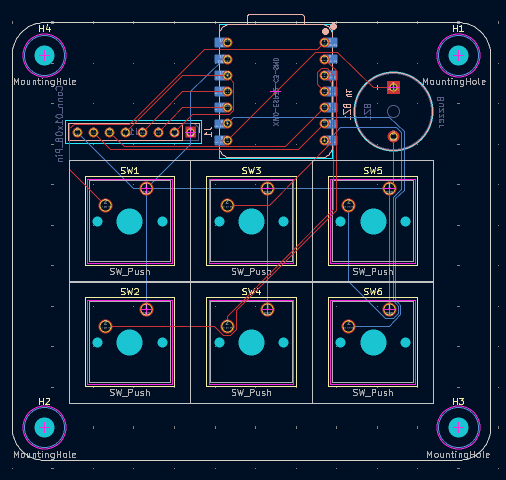
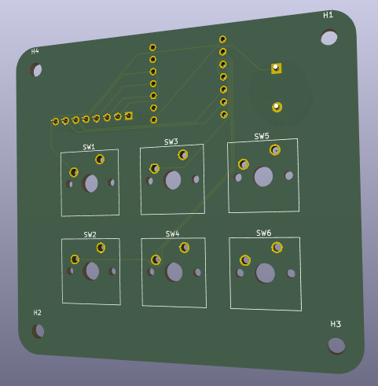

# WakeUpDudeItsSchoolTime
WakeUpDudeItsSchoolTime is an alarm clock with 6 keys, a TFT screen and a buzzer (to make the alarm sounds ofc)


## Features
- Time is automatically synced with Wi-Fi
- Allows up to 5 alarms at a time
- Configurations saved to system memory
- Different themes
- Time zone support, with manual daylight savings toggle

## CAD Design
I used OnShape to design my 3D model. The top and bottom are secured with screws to keep everything sturdy.


This simple design comprises of 2 seperate parts. The main shell used for holding the PCB and all of the keys, and the cover. [Onshape Link](https://cad.onshape.com/documents/61f7fc762917904c003c24e4/w/2d7d6437887083c7ad1da611/e/ae8d4ad74be62245f16cf310?renderMode=0&uiState=6acc61c17a0076c403724d2a)

## PCB Design
The PCB was designed using KiCad. I had to wire BL directly to GND and RST to +3.3V in order to allow enough pins for my 6 buttons.





## Firmware
#### PLEASE NOTE, IT IS RECOMMENDED TO REPLACE THE WIFI SSID IN THE FIRMWARE WITH YOUR OWN.

WakeUpDudeItsSchoolTime uses firmware written in C.

Below is the layout of the switches:
```
SW1  SW3  SW5

SW2  SW4  SW6
```

- SW1 is `select / menu`
- SW2 is `back / cancel`
- SW3 is `up`
- SW4 is `down`
- SW5 is `alarm menu`
- SW6 is `sleep`

When you first boot up, it first asks you for your time zone (you enter the value to add to gmt), then it asks whether daylight savings applies. These customisations are saved to the internal memory. The alarm clock will show time on the main screen. You can add alarms by going into the menu, or by pressing the alarm menu hotkey (SW5). Once power cycled, it will not keep the time, but uses WIFI to resync time using the internet.

## Bill of Materials (BOM)
Here is everything you will need to build WakeUpDudeItsSchoolTime:

- 1x Seeed XIAO ESP32C3
- 6x MX-Style Keyboard Switches
- 6x White Blank DSA Keycaps
- 1x 2.25in TFT Screen
- 1x 3.3V Piezo Buzzer
- 1x 2.54mm 8 Pin Male Header (For connecting your screen)
- 8x 20cm Female-Female Jumper Wires (For connecting your screen off of the pcb)
- 8x M3x5x4 Heatset Inserts
- 4x M3x8mm Screws
- 4x M3x16mm Screws

---

This is the second time I've used KiCAD for PCB design and my first time designing an alarm clock like this. I've learned a lot from this project. Thanks to the Hackclub (and Stardance) team for providing these amazing resources that helped make this dream of mine come true.

Here is the guide I followed. [Link](https://blare.hackclub.com/index.html)